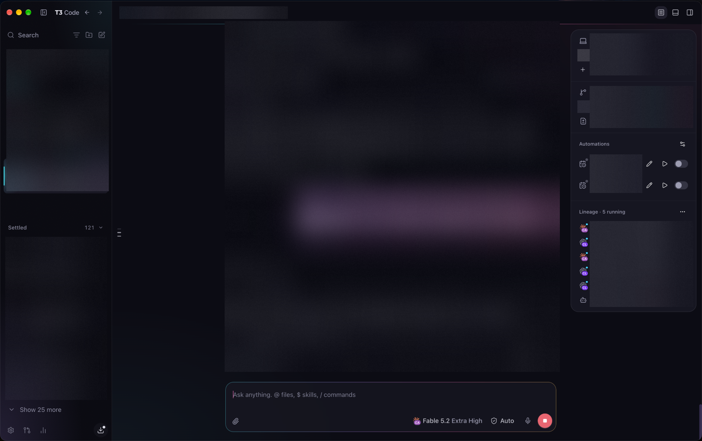

# Afterglow

A dark theme for [T3 Code](https://t3.codes) with multicolor neon accents that stay out of the way.

*Afterglow running in T3 Code (private details removed).*

The idea is a dim room with a few lights on: nearly everything is dark ink, and colour only shows as thin lines, small marks, and glow when you interact.

## Install

1. Download [`afterglow.theme.json`](afterglow.theme.json).
2. In T3 Code, open **Settings → Appearance → Add a theme → Theme file** and choose it.

To undo, pick any built-in theme (t3-chat, grove, ocean, ember, iris).

## What it changes

- **Colour roles:** cyan for focus and links, violet for buttons and selection, pink for your messages and the caret, mint for switches that are on and the terminal cursor, amber for warnings and search matches.
- **Composer:** a 1px gradient ring with the whole spectrum. It is dim at rest and brightens with a soft glow while you type.
- **Sidebar threads:** each row gets its own colour, shown only as a small bar and bloom on hover or when the thread is open.
- **Reading:** headings get a faint tint per level, and list markers, quote bars, inline code and code blocks carry small touches of colour.
- **Shape:** corners are about 25% rounder, user bubbles get a tighter tail corner, and icon strokes are slightly thinner.

All text and surface pairs meet WCAG AA contrast. The theme is dark only.

## License

MIT
